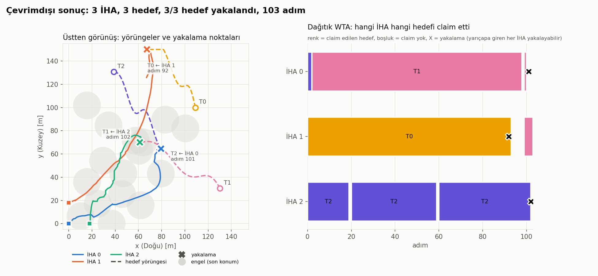

# Distributed Multi-UAV Target Assignment (ROS 2 + PX4)

> 🚧 **Status: in progress.** This is my graduation project (Marmara University, Electrical-Electronics Engineering, 2026-2027).

Several UAVs track and intercept **moving targets** with **no central assignment node**.
Each drone runs its own ROS 2 agent: it estimates where targets are going, plans its own
3D path around obstacles, and resolves conflicts with the others through a shared,
cost-based **claim** rule (a decentralised weapon-target-assignment, WTA).

**Stack:** ROS 2 Jazzy · PX4 SITL (x500) · Gazebo Harmonic · uXRCE-DDS · Python (rclpy, NumPy, SciPy)



## Architecture

```
            world_node  -- TargetArray (noisy measurements) -->  uav_agent_node x N
   (true target + obstacle motion)                               |  own UKF per target
                                                                 |  candidate generation + 3D path
                                                                 |  Claim <-> Claim (peer to peer)
                                                                 v
                                        PX4 offboard: TrajectorySetpoint / VehicleCommand
                                                                 |
                                                         PX4 SITL + Gazebo
            gz_viz_node: draws targets, obstacles, claims and planned paths in Gazebo (gz-transport markers)
```

| Component | What it does |
|---|---|
| `uav_agent_node.py` | One per UAV. Decision loop + flight: arming, take-off/mission state machine, PX4 offboard control. The **10 Hz control loop runs in its own thread**, separate from heavy planning, so planning time never stalls the setpoint stream. Emergency avoidance against obstacles and other UAVs. |
| `world_node.py` | Simulates the "real world": true target and obstacle motion, publishes noisy measurements. |
| `gz_viz_node.py` | Live visualisation in Gazebo via gz-transport markers and a camera that follows the action. |
| `frames.py` | NED ↔ ENU conversion, PX4 topic names, QoS profiles matched to PX4 (`BEST_EFFORT`). |
| `iha_wta_msgs` | Custom messages: `Target`, `TargetArray`, `UavState`, `Claim`. |
| `launch/wta.launch.py` | Starts world, visualisation and N agents. |
| `scripts/start_sim.sh` | Launches MicroXRCEAgent, N PX4 SITL instances and all ROS 2 nodes in tmux with one command. |
| `tools/offline_sim.py` | Runs the same decision logic in discrete time without ROS/Gazebo and renders the figure above. |

## How the decentralised assignment works

1. Every UAV keeps its own target estimates and builds a candidate for each target (direct chase, predicted intercept point, or loiter when the target is hidden behind an obstacle).
2. It publishes a `Claim` with its cost for the target it wants.
3. It only sees the claims other UAVs **published in the previous round**, never their internal state. Conflicts are resolved by the same cost-ordered rule on every UAV, so all agents converge on the same assignment without a coordinator.

## What is (not) in this repo

The ROS-independent algorithm core (`iha_wta/core/`: UKF target estimation, 3D A*,
SciPy SLSQP path smoothing, target/obstacle model) is based on my advisor's unpublished
research code and is **kept private**. This repository contains my ROS 2 / PX4
integration: the distributed agent architecture, messages, offboard flight control,
visualisation and tooling. See [`core/README.md`](ros2_ws/src/iha_wta/iha_wta/core/README.md).

## Running (with the private core available)

```bash
# PX4-Autopilot, Micro-XRCE-DDS-Agent and px4_msgs (matching your PX4 version) are required
cd ros2_ws && colcon build && source install/setup.bash
./scripts/start_sim.sh 3 3     # 3 UAVs, 3 targets
./scripts/stop_sim.sh
```

## Roadmap

- [x] Distributed claim-based assignment over ROS 2 messages
- [x] PX4 offboard control for N vehicles, frame conversion, QoS matching
- [x] Obstacle and inter-UAV emergency avoidance
- [x] Gazebo live visualisation
- [ ] Communication delay / packet loss scenarios
- [ ] Camera-based target detection instead of simulated measurements
- [ ] Evaluation metrics and comparison against a centralised assignment

Code comments are in Turkish.
